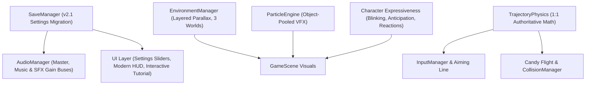

# GEM FEEDER — PHASE 11 IMPLEMENTATION PLAN
## Premium Visuals, Realistic Gameplay, Character Animation & Commercial-Quality UI

**Date:** November 22, 2026  
**Status:** In Progress (Direct Execution)  
**Target Branch:** `feature/phase-11-premium-game-experience`  
**Base Release:** Phase 10 (`0684ab0a080c97d28dc1323ad5c948dd55ca02eb`)  

---

## 1. Architectural Strategy & Design Principles

To elevate GEM Feeder to commercial casual arcade standards without destabilizing Phase 10's proven systems, Phase 11 introduces focused, modular enhancements:

### Core Tenets:
1. **Preserve Asset Identity:** Keep all 9 character mouth frames (`mouth_0`..`mouth_8`) and all 8 vector SVG candies completely intact. Enrich them with procedural highlights, rotation physics, and layered expressions.
2. **Unified Trajectory Math:** Guarantee 100% mathematical fidelity between the aim guidance dots and actual candy flight.
3. **Multi-World Visual Identity:** Establish unmistakable visual distinctiveness across Candy Garden, Sugar Mountain, and Chocolate Kingdom.
4. **Independent Audio Control:** Provide discrete volume sliders for Music and SFX, alongside existing toggle switches.
5. **Zero GC Stutter:** Implement object pooling for visual particles and temporary physics objects to maintain 60+ FPS on all devices.

---

## 2. Staged Execution Plan

### Stage 1: Repository Audit, Skill Discovery & Architecture Setup (Completed)
- Create `PHASE_11_AUDIT.md`, `PHASE_11_SKILLS_REPORT.md`, `PHASE_11_IMPLEMENTATION_PLAN.md`.
- Establish working branch `feature/phase-11-premium-game-experience`.

### Stage 2: Visual Environments & Layered Parallax
- Create `src/systems/EnvironmentManager.js`:
  - 3-layer parallax system (distant horizon, midground scenery, foreground ambient props).
  - **Candy Garden Theme:** Gentle pastel green/pink gradient, rolling candy hills, swaying flowers, drifting clouds, floating bubbles.
  - **Sugar Mountain Theme:** Snowy peaks, frosted candy trees, swirling procedural snow particles, cool blue tones.
  - **Chocolate Kingdom Theme:** Chocolate fortress spires, candy pillars, glowing caramel streams, magical floating golden motes.
  - Smooth camera subtle breathing/drift.
- Integrate into `GameScene.js` and `HomeScene.js`.

### Stage 3: Candy Rendering Polish & Object-Pooled Particle Engine
- Create `src/systems/ParticleEngine.js`:
  - Pre-allocated pool of particles (sparks, stars, sparkles, candy crumbs, coin bursts, hearts).
  - Methods: `emitPickup()`, `emitLaunch()`, `emitCatch()`, `emitPerfectCatch()`, `emitMiss()`, `emitComboMilestone()`, `emitCoinCollect()`, `emitLevelVictory()`.
- Upgrade `src/objects/Candy.js`:
  - Procedural glossy highlight shine.
  - Dynamic spin rate derived from launch angular velocity and trajectory curvature.
  - Smooth stretch-and-squash along velocity vector during flight and upon landing.
  - Motion trail ribbon following candy center.

### Stage 4: Character Animation & Personality Upgrades
- Enhance `src/objects/Character.js`:
  - **Procedural Eye Blinking:** Eyelid blink animation cycling every 3.5–5 seconds.
  - **Mouth Anticipation:** Mouth pre-opens to `mouth_1` when candy is aimed directly at mouth or flying close.
  - **Reactive Expressions:**
    - Normal catch: Satisfied double bounce and chewing sequence.
    - Perfect catch: Full radiant celebration hop, mouth open wide (`mouth_8`), gold sparkle aura.
    - Missed candy: Subtle sad droop and disappointed glance.
    - Level complete: Continuous victory celebration pose.
  - Synchronized strictly with actual physics events; supports `reducedMotion` settings.

### Stage 5: Gameplay Physics & Authoritative Trajectory Solver
- Create `src/systems/TrajectoryPhysics.js`:
  - Single authoritative physics solver for both trajectory aim dots and physical candy flight.
  - Accurate parabolic gravity ($750\text{ px/s}^2$), drag damping, wind sway offset (in World 2 & 3), and power-up modifiers (Slowmo 0.55x, Magnet pull, Precision extended arc).
- Upgrade `CollisionManager.js`:
  - Real-time mouth hitbox position dynamically synced with character sine-sway ($x \pm 35\text{px}$ to $x \pm 50\text{px}$).
  - Strictly prevent duplicate scoring per candy instance.
- Upgrade `InputManager.js`:
  - Smoothed pointer drag with elastic tension curves for slingshot and flick modes.

### Stage 6: Audio & Haptics Engine Upgrades
- Upgrade `src/storage/SaveManager.js`:
  - Versioned migration to v2.1 adding `musicVolume` (default 0.7) and `sfxVolume` (default 0.85).
- Upgrade `src/systems/AudioManager.js`:
  - Discrete gain buses: `masterGain`, `musicGain`, `sfxGain`.
  - Methods: `setMusicVolume(vol)`, `setSFXVolume(vol)`, `getMusicVolume()`, `getSFXVolume()`.
  - Expand procedural sound synthesizer:
    - Candy pickup & drag tension hum.
    - Clean launch swoosh.
    - Delicious crunch/munch chewing sound.
    - Resonant golden bell chime for perfect hits.
    - Low cushioned thud for missed throws.
    - Ascending combo fanfare.
    - Coin clink sound.
    - Victory fanfare and defeat jingle.
  - Multi-tier haptics API integration with graceful fallback.

### Stage 7: Commercial-Quality UI/UX Redesign
- **HomeScene:** Animated floating logo with candy shine, hero character preview with cosmetics, primary "PLAY" button with rhythmic pulse, quick-access cards for Campaign, Endless Arcade, Shop, and Quests.
- **Interactive Tutorial (`TutorialScene.js`):** Hands-on 3-step interactive micro-lessons (Aim & Throw -> Catch -> Perfect Hit & Power-Ups) with interactive controls, Skip, and Replay buttons.
- **HUD (`HUD.js`):** Streamlined layout, animated combo badge, level goal progress bar, 5-slot power-up action shelf with active status rings.
- **PauseMenu & GameOverScene:** Polished visual design, animated score tally rollup, clear retry/home/settings actions.
- **SettingsMenu:** Interactive sliders for Music Volume and SFX Volume, switches for Sound, Music, Vibration, and Reduced Motion.

### Stage 8: Performance Optimization & Comprehensive Automated Tests
- Benchmark frame rates to ensure sustained 60+ FPS across all 3 worlds and particle bursts.
- Write new automated unit tests in `tests/phase11_experience.test.js` covering:
  - Trajectory physics solver 1:1 parity.
  - Volume controls and gain bus math.
  - EnvironmentManager world theme switching.
  - Particle engine pooling and allocation limits.
  - Character animation state transitions and blink timer.
  - SaveManager v2.1 settings migration.

### Stage 9: Browser E2E, Responsive Screenshots & Documentation
- Execute Playwright headless Chrome automation across all 6 viewports (375x667, 390x844, 412x915, 768x1024, 1024x768, 1440x900).
- Capture screenshots for all updated screens.
- Generate Phase 11 reports (`PHASE_11_IMPLEMENTATION_REPORT.md`, `PHASE_11_TEST_REPORT.md`, `PHASE_11_VISUAL_QA.md`, `PHASE_11_PERFORMANCE_REPORT.md`, `PHASE_11_ASSET_LICENSE_REPORT.md`, `PHASE_11_RELEASE_CHECKLIST.md`, and updated `README.md`).
- Await user release authorization before any Git commit, merge, or push.
